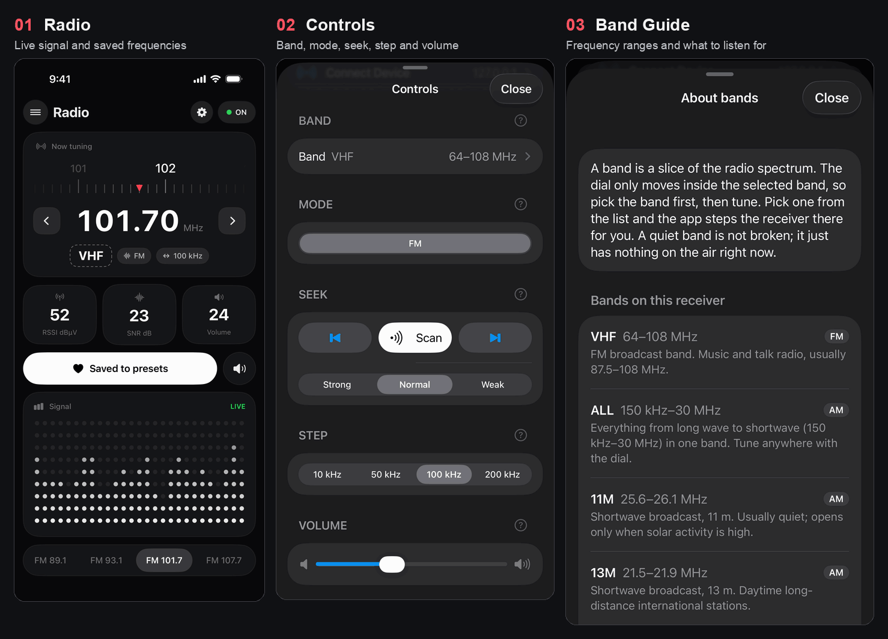

# ATS Mini Remote

**English** · [한국어](README.ko.md)

iOS remote controller for ATS Mini radio receivers.

## Screenshots

[](docs/images/ats-mini-remote.gif)

Captured in the iOS Simulator with a mock ATS Mini receiver over Wi-Fi TCP.

**ATS Mini Remote** is an iOS app that finds and connects to an ATS Mini radio receiver from your iPhone and lets you tune the frequency, adjust the volume and more. `ats-mini-ios` is the source repository of the app.

**Status** · The control screen UI and the BLE connection code are implemented. BLE has **not been verified on real hardware (iPhone + ATS Mini) yet** because the iOS Simulator has no Bluetooth. Wi-Fi TCP is implemented and has been exercised end to end in the iOS Simulator against the bundled mock receiver (see *Try it in the iOS Simulator*), but not on a real receiver.

## Connect over Bluetooth

1. On the ATS Mini, open `Settings → Bluetooth` and turn on `Ad hoc` mode.
2. On your iPhone, open the app and tap the **ON/OFF chip** (top right) or **menu → Connect Device**. Allow Bluetooth access the first time.
3. Pick your ATS Mini from the list of nearby receivers.
4. Once connected, control frequency, volume, band and mode from the main screen.

A receiver you have connected once is reconnected automatically when the app starts, and the app keeps retrying if the connection drops. The header chip shows the connection state and lets you disconnect.

## Connection methods

| Method | Required setup | Plan |
| --- | --- | --- |
| Bluetooth LE (BLE) | `Bluetooth → Ad hoc` on the receiver and the iOS Bluetooth permission | Primary. Finds and connects to the receiver from the app, with no router or IP address. |
| Wi-Fi TCP | Receiver Wi-Fi, `TCP Port → Ad hoc`, and the iOS local network permission | Secondary. Implemented: enter the host and port in **Connect Device → Wi-Fi TCP** (default `atsmini.local`, port `60000`). Works in the Simulator against the mock receiver. |

BLE is the easiest way to connect right next to the receiver. Wi-Fi is convenient if the receiver stays on your home router. The ATS Mini firmware documentation recommends using only one of Wi-Fi and Bluetooth at a time for stability. [ATS Mini remote control docs](https://esp32-si4732.github.io/ats-mini/remote.html) · [Receiver manual](https://esp32-si4732.github.io/ats-mini/manual.html) · [iOS local network privacy](https://developer.apple.com/documentation/technotes/tn3179-understanding-local-network-privacy)

## Control screen UI

A portrait UI built from dark rounded cards on a near-black background. The layout follows a [radio app concept (GIF)](https://i.pinimg.com/originals/02/ae/b4/02aeb4bf8f22a177054f7e702493fa30.gif), the card style follows a monochrome dashboard concept, and the controls follow [ATS-Mini-Companion](https://github.com/rodillo69/ATS-Mini-Companion) and [ATS Mini Controller](https://atsminiradio.com/en).

- **Now tuning card**: a dial ruler with a red pointer at the current frequency. Drag it left or right to tune in steps (tick spacing: FM 0.1 MHz, LW 1 kHz, MW/SW 10 kHz). Also shows the big `101.70 MHz` readout, `‹ ›` buttons, the band in a dashed box, and mode and step chips.
- **Status tiles**: RSSI, SNR and volume as big-number tiles. Tap the volume tile for a popup with a slider (0–63) and a mute button.
- **Buttons**: a white pill button saves or removes the current frequency as a preset; the round button next to it mutes. While connected, the heart saves to / clears a **memory slot on the receiver**; while offline it saves an app-only preset.
- **Signal card**: a dot-matrix equalizer driven by signal strength and volume (decorative) and a `LIVE` status. It collapses to the bottom rows when muted or offline.
- **Station bar** at the bottom: a pill bar with the entry matching the current frequency highlighted. While connected it shows the **receiver's memory slots** (named slots show their name); offline it shows the presets you saved in the app (none by default). Tapping a slot switches the receiver to that slot's band and mode first, then sets the frequency.
- **Seek / Scan** (Controls, needs a connected receiver): the ◀ ▶ buttons step through the band one tuning step at a time and stop at the next station whose RSSI and SNR reach the chosen sensitivity (Strong / Normal / Weak = RSSI 30/20/10 dBµV, SNR 12/8/3 dB). Scan keeps going and pauses about 4 seconds on each station until you press Stop. The signal is read from the status line at each step (about a second per step), so a larger tuning step is faster; FM covers 87.5–108 MHz. Turning the dial or pressing the arrows stops it. The receiver has no seek command in the Ad hoc protocol, so this is done by the app.
- **Header**: menu (Connect Device at the top, then band, mode, step and volume; while connected, band is picked from a list of the receiver's 28 bands with their frequency ranges and mode from a segmented control). Every item has a **`?` button** at the right of its title that explains what it does; the band help lists each band with a short description of what you can hear on it, a gear button (advanced settings) and the ON/OFF connection chip.
- **Advanced settings (gear)**: controls for advanced users. They need a connected receiver.
  - −/+ buttons for bandwidth (`W`/`w`), AGC/attenuator (`A`/`a`) and calibration (`I`/`i`). Bandwidth shows the receiver's own value and AGC its list position. Each section has a `?` help button that also works while offline.
  - Sleep on / wake up (`O`/`o`).
  - Receiver encoder: rotate left/right (`r`/`R`), click (`e`) and short press (`E`) to operate the receiver menu.
  - Memory slots: read the 99 slots (`$`, also read automatically after connecting), save the current frequency and a name to the first empty slot (`#`), clear a slot (sends `#` with frequency 0, with a confirmation), and tap a slot to tune to it.
  - Communication log: commands sent and lines received, the latest status line and a status-line counter, with a Copy button for bug reports.
- While not connected the app runs on demo values (`OFF`); once connected, values follow the status the receiver sends (`ON`).

### Splash screen, app icon and languages

- **Splash**: the launch screen (the same dark background as the app plus the dial logo) is followed by the logo in the same position and the app name fading in, then the main screen. The logo and app icon are a dial ruler with a red pointer.
- **Languages**: English (default) and Korean. The app follows the iPhone language. UI strings live in `ATSMiniRemote/Localizable.xcstrings` and the Bluetooth permission text in `ATSMiniRemote/*.lproj/InfoPlist.strings`. To add a language, add translations to the same files.

### BLE implementation

The protocol follows the [ATS Mini remote control docs](https://esp32-si4732.github.io/ats-mini/remote.html) (shared by USB serial, BLE and TCP).

- **Connection**: scans for the Nordic UART Service (`6E400001-B5A3-F393-E0A9-E50E24DCCA9E`). The docs do not list the characteristic UUIDs, so the notify characteristic is used for receiving and the write characteristic for sending, found by their properties. A receiver connected once is reconnected automatically on launch and after drops. Pick a receiver from the header chip or `menu → Connect Device`.
- **Status**: after connecting, the app sends `t` (toggle log) to receive the 15-field status line and reflects it on screen. Verified against the firmware v2.45 source: field 13 is the battery voltage as a decimal (`4.05`), not an ADC integer as the docs say, and the step and bandwidth fields are text such as `100k` / `2.5k`. The band name (e.g. `VHF`, `31M`) and mode shown in the app come from this line. Error replies such as `Error: Frequency is out of range for the current band` are shown as a short message. The log is off right after a reconnect, and because `t` is a toggle, it is only sent when no status line arrives.
- **Control**: the dial, arrows and presets send `F<Hz>` (set frequency); volume uses `V`/`v`, band `B`/`b` and mode `M`/`m`. After each frequency command the app checks the status line: if the receiver did not move, it retries with encoder rotation (`R`/`r`, sized with the receiver's reported step) and, if that fails too, restores the display and shows a message. Old status lines never overwrite a frequency you just set. In SSB modes the frequency shown is `kHz×1000 + BFO`. While dragging the dial, only the latest value is sent every 120 ms so commands do not flood the receiver.
- **Not implemented**: the receiver screenshot (`C`/`c`) and theme get/set (`@`/`^`). A screenshot is a large BMP transfer (about 30 s over BLE) whose decoding cannot be verified without hardware.
- **Band list**: the receiver has no command that lists its bands, so the list is the `bands[]` table from the firmware v2.45 source (`VHF`, `ALL`, `11M` … `CB`). `B` steps through it in that order, so the app presses `B`/`b` one step at a time in the shorter direction and checks the status line after each press. `15M` appears twice (broadcast and amateur), so the current frequency is used to tell them apart. Other firmware or forks may have a different table; if the receiver reports a band that is not in the table, the menu falls back to ◀ ▶ buttons.
- **Station list and memory slots**: the `#` input is echoed back by the receiver, so slot lines are only read for 1.2 s after a `$` request (not from the echo), the list is swapped in at the end instead of being cleared first, and if the receiver does not report the slot you just saved, a message says so.
- **Limitations**: the `F` command only works inside the receiver's current band, so the app first steps the receiver to the slot's band with `B` (up to 40 tries, checking the status line each time) and the mode with `M`. The app's step is the app-side tuning interval and is separate from the receiver's step setting. Memory slot writes only happen after the slot list has been read, so an existing slot is never overwritten by mistake.
- **Tests**: status line parsing and command strings are covered by unit tests (`ATSMiniRemoteTests`).

### Try it in the iOS Simulator

The Simulator has no Bluetooth, so use Wi-Fi TCP with the mock receiver in [`tools/mock_ats_mini.py`](tools/mock_ats_mini.py) (Python 3, no dependencies). It follows the firmware v2.45 source: input framing, the echo of `F` and `#` input, `Error:` replies, the 15-field status line, the 28-band table, 99 memory slots and the `#` validation rules, plus a few fake stations (FM 89.1, 93.1, 101.7, 107.7, MW 1134, SW 9620 …) so Seek and Scan have something to find.

```bash
python3 tools/mock_ats_mini.py            # listens on 127.0.0.1:60000
python3 tools/mock_ats_mini.py -v         # also print every command it receives
python3 tools/mock_ats_mini.py --no-f     # behave like firmware without the F/# commands (tests the encoder fallback)
python3 tools/mock_ats_mini.py --drop-memory-write   # accept # but do not store it (tests the save-failed message)
```

In the app open **Connect Device → Wi-Fi TCP**, enter host `127.0.0.1` and tap **Connect**. This is a development aid and not a real receiver: it can only be as accurate as the firmware source it was written from.

### Build

The Xcode project is generated with [XcodeGen](https://github.com/yonaskolb/XcodeGen) (`project.yml`). iOS 17 or later is required.

```bash
brew install xcodegen
xcodegen generate
open ATSMiniRemote.xcodeproj
```

## Roadmap

- [x] SwiftUI radio control screen (dial, equalizer, station bar).
- [x] Connect-device screen.
- [x] BLE scan, device selection, connection and reconnection with Core Bluetooth. (needs hardware verification)
- [x] Control frequency, volume, band and mode and show receiver status using the ATS Mini Ad hoc protocol. (needs hardware verification)
- [x] Advanced settings: bandwidth, AGC, calibration, sleep, encoder and memory slots. (needs hardware verification)
- [x] Splash screen, app icon, and English/Korean localization.
- [ ] Show the receiver step, and add screenshot and theme support.
- [x] Wi-Fi TCP using the same radio commands as BLE, plus a mock receiver for Simulator testing.
- [x] Seek and Scan.
- [ ] Verify BLE, memory slots, frequency control and Seek/Scan on a real ATS Mini.

Development targets the [ESP32-SI4732 ATS Mini firmware](https://github.com/esp32-si4732/ats-mini), which provides the `Ad hoc` remote control mode. Supported firmware versions and device combinations will be confirmed on a real iPhone and ATS Mini.

## Future work

If an Android app and a shared protocol library are developed, they can be split into `ats-mini-android` and `ats-mini-protocol`.
